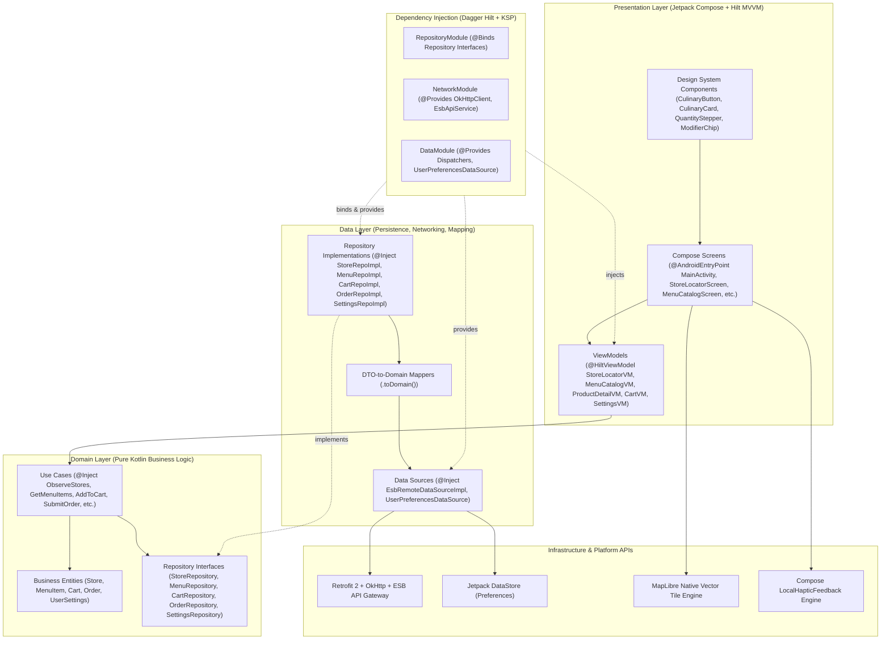
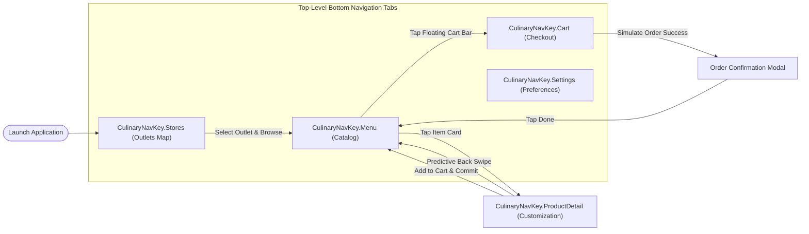
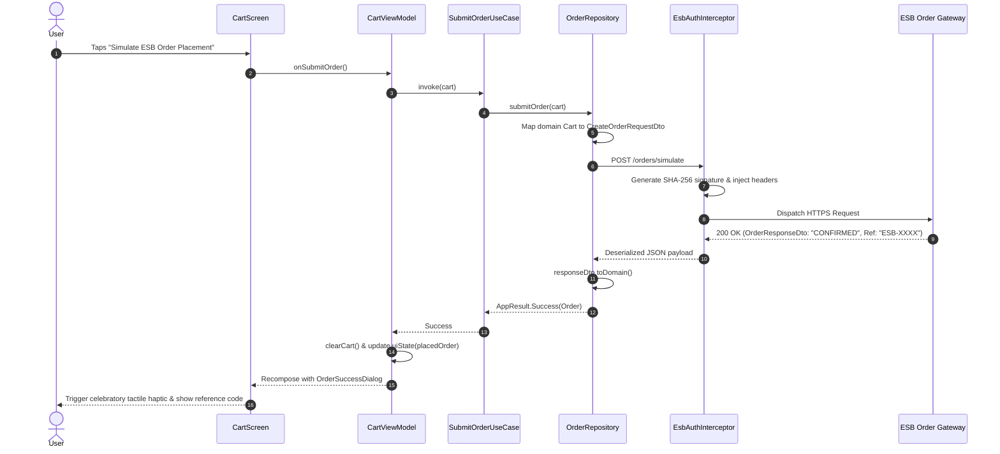
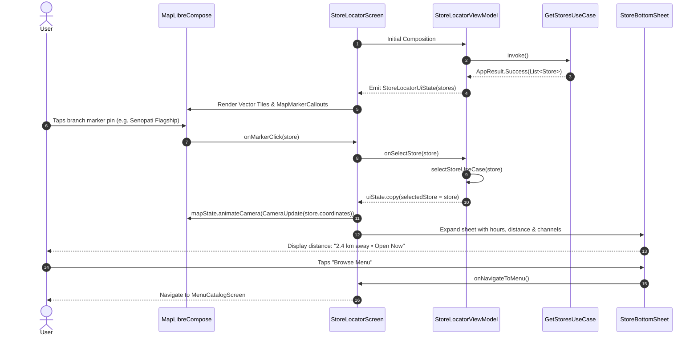
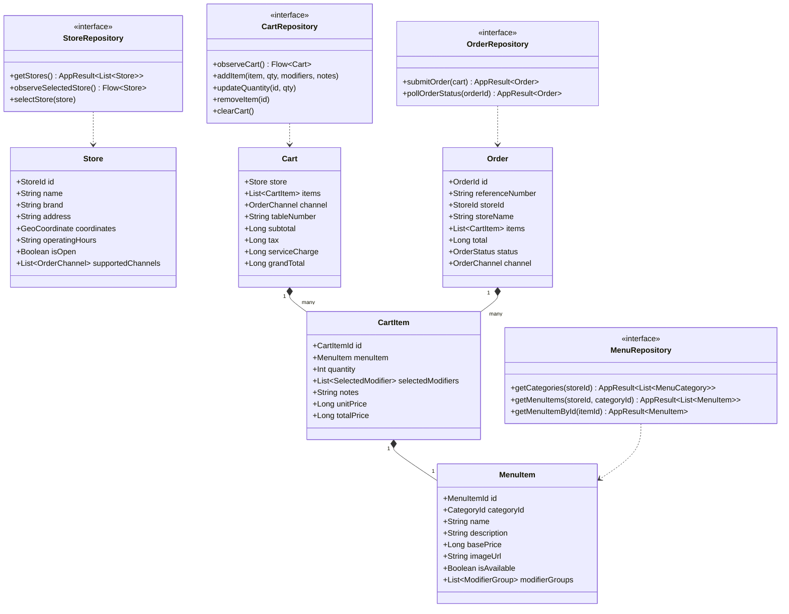
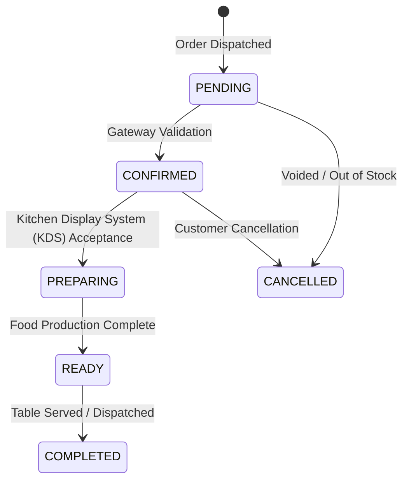

# CulinaryLoop Design System & Architecture Specification

An exhaustive reference manual for the modern Android Food & Beverage client integrating with the **PT Esensi Solusi Buana (ESB)** API platform. This document defines design tokens, component specifications, formal domain use cases, and structural UML diagrams adhering strictly to Clean Architecture and Material 3 standards.

---

## 1. Design Tokens & System Foundations

### 1.1 Color Palette & Semantic Color Roles

The CulinaryLoop visual language reflects artisanal gastronomy—incorporating deep espresso roasts, roasted coffee crema, warm terracotta amber, and organic ceremonial matcha.

| Token | Light Mode Hex | Dark Mode Hex | Usage / Semantic Role |
| :--- | :--- | :--- | :--- |
| **`Primary`** | `#C85A17` (Terracotta Amber) | `#FFB596` (Warm Peach) | Key actionable elements, primary buttons, active indicator pills |
| **`OnPrimary`** | `#FFFFFF` | `#581E00` | Text/icons rendered on top of `Primary` containers |
| **`PrimaryContainer`** | `#FFDBCF` | `#7A2E00` | Prominent highlights, badge backgrounds, selected cart chip fills |
| **`OnPrimaryContainer`** | `#381400` | `#FFDBCF` | Text and icons inside `PrimaryContainer` |
| **`Secondary`** | `#765849` (Crema Brown) | `#E6BEAB` | Auxiliary badges, secondary icons, subtitle accents |
| **`OnSecondary`** | `#FFFFFF` | `#432B1E` | Text on secondary surfaces |
| **`SecondaryContainer`**| `#FFDBCF` | `#5C4133` | Tonal button containers, category tab unselected states |
| **`Tertiary`** | `#55643B` (Matcha Sage) | `#BCCE8C` | Specialty dietary indicators, organic flags, promo highlights |
| **`Background`** | `#FCF9F7` (Bakery Porcelain)| `#181210` (Dark Roast) | Root screen container canvas |
| **`Surface`** | `#FCF9F7` | `#181210` | Card bodies, bottom sheets, navigation bars |
| **`SurfaceVariant`** | `#F4DED5` | `#52443D` | Text field containers, chip stroke fills |
| **`Outline`** | `#85736C` | `#A08D85` | Unselected boundaries, dividers, card borders |
| **`OutlineVariant`** | `#D7C2B9` | `#52443D` | Subtle borders, disabled divider lines |
| **`StatusOpen`** | `#2E7D32` (Forest Green) | `#2E7D32` | Restaurant branch actively open status pill |
| **`StatusClosed`** | `#C62828` (Crimson) | `#C62828` | Restaurant branch currently closed status pill |

---

### 1.2 Typography Hierarchy

Typography maps to the Android Material 3 type system utilizing system sans-serif font geometry with strict tracking and line height discipline:

| Style Role | Font Size | Line Height | Font Weight | Tracking | Usage |
| :--- | :--- | :--- | :--- | :--- | :--- |
| **`displayLarge`** | `57sp` | `64sp` | Bold (700) | `-0.25sp` | Brand splash & promotional billboards |
| **`displayMedium`**| `45sp` | `52sp` | Bold (700) | `0.0sp` | Featured culinary collection headers |
| **`headlineLarge`** | `32sp` | `40sp` | SemiBold (600) | `0.0sp` | Order confirmed checkout headers |
| **`headlineMedium`**| `28sp` | `36sp` | SemiBold (600) | `0.0sp` | Product detail title |
| **`headlineSmall`** | `24sp` | `32sp` | SemiBold (600) | `0.0sp` | Screen header titles (Catalog, Cart, Settings) |
| **`titleLarge`** | `22sp` | `28sp` | SemiBold (600) | `0.0sp` | TopAppBar headers, Card section headings |
| **`titleMedium`** | `16sp` | `24sp` | Medium (500) | `0.15sp` | Product card titles, Modifier group titles |
| **`titleSmall`** | `14sp` | `20sp` | Medium (500) | `0.10sp` | Summary row titles, Stepper value label |
| **`bodyLarge`** | `16sp` | `24sp` | Normal (400) | `0.5sp` | Main descriptions, Settings switch labels |
| **`bodyMedium`** | `14sp` | `20sp` | Normal (400) | `0.25sp` | Menu item description paragraphs |
| **`bodySmall`** | `12sp` | `16sp` | Normal (400) | `0.4sp` | Distance badges, secondary metadata, notes |
| **`labelLarge`** | `14sp` | `20sp` | Medium (500) | `0.1sp` | Button text, Category tab text |
| **`labelMedium`** | `12sp` | `16sp` | Medium (500) | `0.5sp` | Chip text, Map pin callout labels |
| **`labelSmall`** | `11sp` | `16sp` | Medium (500) | `0.5sp` | Modifier surcharge (+Rp 8.000) tags |

---

### 1.3 Spacing, Dimensions & Elevation Grid

CulinaryLoop enforces an 8dp/4dp harmonic layout system:

* **Spatial Grid Tokens (`CulinarySpacing`):**
  * `none`: `0dp`
  * `xxs`: `2dp`
  * `xs`: `4dp`
  * `s`: `8dp`
  * `m`: `12dp`
  * `l`: `16dp`
  * `xl`: `24dp`
  * `xxl`: `32dp`
  * `xxxl`: `48dp`
* **Corner Radius Shapes (`CulinaryDimensions`):**
  * `RadiusSmall`: `8dp` (Tags, status badges, thumbnails)
  * `RadiusMedium`: `12dp` (Cards, text fields, action buttons)
  * `RadiusLarge`: `16dp` (Bottom sheet panels, dialog containers)
  * `RadiusExtraLarge`: `24dp` (Predictive back morphed surfaces)
  * `RadiusPill`: `999dp` (Category tabs, quantity steppers, chips)
* **Elevation & Shadow Tokens:**
  * `ElevationNone`: `0dp`
  * `ElevationLow`: `1dp` (Default resting card)
  * `ElevationMedium`: `3dp` (Pressed card, category sticky bar)
  * `ElevationHigh`: `6dp` (Floating search pill, map callouts)
  * `ElevationDialog`: `12dp` (Bottom sheets, modals)
* **Touch Targets & Assets:**
  * `MinTouchTarget`: `48dp` (Accessibility standard compliance)
  * `HeroImageHeight`: `280dp` (Product detail hero canvas)
  * `ThumbnailSize`: `88dp` (Menu item card preview)
  * `StepperButtonSize`: `36dp` (Round increment/decrement tap targets)

---

### 1.4 Motion & Animation Curves

Transitions honor Material Motion principles:

* **Cubic-Bezier Easing Tokens:**
  * `EmphasizedDecelerate`: `CubicBezierEasing(0.05f, 0.70f, 0.10f, 1.00f)` — Screen entry, bottom sheet reveal.
  * `EmphasizedAccelerate`: `CubicBezierEasing(0.30f, 0.00f, 0.80f, 0.15f)` — Screen dismissal, predictive back peel commit.
  * `StandardEasing`: `CubicBezierEasing(0.20f, 0.00f, 0.00f, 1.00f)` — Color morphs, card expansion.
* **Duration Specs:**
  * `DurationShort2 (100ms)`: Chip selection checkmarks.
  * `DurationShort4 (200ms)`: Quantity stepper value transition.
  * `DurationMedium2 (300ms)`: Shared bounds screen transition.
  * `DurationLong1 (450ms)`: MapLibre camera ease-to-store animation.

---

### 1.5 Tactile Haptic Classification Matrix

Sensory feedback is driven through `LocalAppHapticFeedback` mapped strictly to user intention:

| Trigger Event | Haptic Class | System Constant | Sensory Feel |
| :--- | :--- | :--- | :--- |
| **Quantity Stepper (+ / -)** | Segment Tick | `HapticFeedbackType.SegmentTick` | Crisp, low-amplitude click |
| **Category Pill Selected** | Virtual Key | `HapticFeedbackType.VirtualKey` | Light tactile pulse |
| **Map Marker Tapped** | Context Click | `HapticFeedbackType.ContextClick` | Sharp localized snap |
| **Theme / Lang Switch** | Toggle On/Off | `HapticFeedbackType.ToggleOn` / `ToggleOff` | Definite state shift click |
| **Add to Cart Committed** | Confirm Pulse | `HapticFeedbackType.Confirm` | Satisfying double-frequency buzz |
| **Order Placed via ESB** | Confirm Heavy | `HapticFeedbackType.Confirm` | Deep celebratory confirmation |
| **Predictive Back Threshold** | Threshold Cross | `HapticFeedbackType.GestureThresholdActivate` | Subtle mechanical detent |
| **Input Error / Out of Stock**| Reject Warning | `HapticFeedbackType.Reject` | Double buzz error vibration |

---

## 2. Core Component Library Contracts

### 2.1 `CulinaryButton`
A high-performance tactile action button supporting primary, outlined, and tonal styles with embedded asynchronous loading spinners.

```kotlin
@Composable
fun CulinaryButton(
    text: String,
    onClick: () -> Unit,
    modifier: Modifier = Modifier,
    variant: CulinaryButtonVariant = CulinaryButtonVariant.Primary,
    enabled: Boolean = true,
    isLoading: Boolean = false
)
```
* **Accessibility:** Minimum `48dp` touch height, automatic state announcement ("In progress" during loading).
* **Behavior:** Automatically suppresses duplicate clicks while `isLoading = true`; executes `LocalAppHapticFeedback.performClick()`.

---

### 2.2 `CulinaryCard`
Elevated card container with surface color matching, border definition, and ripple boundaries.

```kotlin
@Composable
fun CulinaryCard(
    modifier: Modifier = Modifier,
    onClick: (() -> Unit)? = null,
    border: BorderStroke? = null,
    content: @Composable ColumnScope.() -> Unit
)
```
* **Behavior:** Emits `1dp` resting tonal elevation; raises to `3dp` upon press.

---

### 2.3 `QuantityStepper`
Numeric stepper control with bound checking (`minQuantity` to `maxQuantity`) and physical tick haptics.

```kotlin
@Composable
fun QuantityStepper(
    quantity: Int,
    onQuantityChange: (Int) -> Unit,
    modifier: Modifier = Modifier,
    minQuantity: Int = 1,
    maxQuantity: Int = 99
)
```
* **Accessibility:** Incremental content descriptions (`cd_increase_qty`, `cd_decrease_qty`).
* **Boundary Guard:** Disables minus button when `quantity == minQuantity`.

---

### 2.4 `ModifierChip`
Single-select and multi-select tags featuring animated selection backgrounds and currency surcharge badges.

```kotlin
@Composable
fun ModifierChip(
    label: String,
    isSelected: Boolean,
    onClick: () -> Unit,
    modifier: Modifier = Modifier,
    priceDelta: Long = 0L
)
```

---

### 2.5 `StickyCategoryHeader`
Scroll-pinned horizontal category bar with translucent blur backdrop and smooth animated selection pills.

```kotlin
@Composable
fun StickyCategoryHeader(
    categories: List<MenuCategory>,
    selectedCategoryId: CategoryId?,
    onSelectCategory: (CategoryId?) -> Unit,
    modifier: Modifier = Modifier
)
```

---

### 2.6 `MapMarkerCallout`
Custom MapLibre pin with animated pop-out bubble displaying outlet open status and branch title upon selection.

```kotlin
@Composable
fun MapMarkerCallout(
    storeName: String,
    isOpen: Boolean,
    isSelected: Boolean,
    onClick: () -> Unit,
    modifier: Modifier = Modifier
)
```

---

## 3. Formal Domain Use Case Specifications

### UC-01: Discover Outlets via Interactive Map
* **Actor:** User.
* **Preconditions:** Location permissions requested; device has network access (or offline demo fallback active).
* **Main Success Scenario:**
  1. User navigates to the Outlets tab.
  2. `StoreLocatorViewModel` retrieves branch coordinates and metadata via `GetStoresUseCase`.
  3. MapLibre renders native vector tiles (Carto Light or Dark depending on active theme).
  4. Outlets appear as interactive pins.
  5. User taps a pin on the map or quick-filter pill.
  6. Map camera smoothly pans and zooms to branch coordinates (`animateCamera`).
  7. `BottomSheetScaffold` expands, revealing branch distance, hours, ordering channels (Dine-in, Takeaway, Delivery).
  8. User taps "Browse Menu".
* **Alternative Flows:**
  * *Geolocation Denied:* App defaults to Jakarta CBD coordinates (-6.2297, 106.8112) without crashing.
  * *Offline Mode:* Seamlessly serves high-fidelity branch data from `MockEsbData`.
* **Postconditions:** Active store is set in `StoreRepository` and synchronized to `CartRepository`.

---

### UC-02: Browse Categorized Menu & Customize Modifiers
* **Actor:** User.
* **Preconditions:** Store branch has been selected.
* **Main Success Scenario:**
  1. System displays catalog with sticky category headers ("Coffee", "Mains", "Snacks", "Desserts").
  2. User scrolls or taps category pill; list smooth-scrolls to section.
  3. User searches dishes using the search bar; results filter reactively.
  4. User taps an orderable item card (e.g. "Gula Aren Espresso Macchiato").
  5. Screen transitions to `ProductDetailScreen` with shared image bounds.
  6. User adjusts modifier options (Sweetness: 70%, Ice: Normal, Milk: Oat Milk +Rp 8.000).
  7. Total price updates dynamically in real-time.
* **Alternative Flows:**
  * *Item Sold Out:* Selection chip is disabled and displays "Sold Out" badge.
* **Postconditions:** Customized item parameters are prepared in `ProductDetailUiState`.

---

### UC-03: Add to Cart with Shared Element Transition & Real-Time Total
* **Actor:** User.
* **Preconditions:** Product modifiers selected in `ProductDetailScreen`.
* **Main Success Scenario:**
  1. User selects quantity via `QuantityStepper` and enters special note ("Less sweet please").
  2. User taps "Add to Cart • Rp XX.XXX".
  3. Sensory confirmation haptic fires (`HapticFeedbackType.Confirm`).
  4. `AddToCartUseCase` commits item to `CartRepository`.
  5. Screen peels back to catalog using predictive back gesture.
  6. Floating Cart bar appears at bottom with updated count badge and subtotal.
* **Postconditions:** Cart state emitted via `StateFlow<Cart>` to all observers.

---

### UC-04: Submit Order Simulation to ESB Backend
* **Actor:** User & ESB Gateway.
* **Preconditions:** Cart contains at least 1 item; fulfillment channel and table number specified.
* **Main Success Scenario:**
  1. User navigates to `CartScreen`.
  2. System displays itemized breakdown: Subtotal, PB1 Tax (10%), Service Charge (5%), Grand Total.
  3. User selects channel (Dine-In) and enters "Table 08".
  4. User taps "Simulate ESB Order Placement".
  5. `SubmitOrderUseCase` maps domain cart to `CreateOrderRequestDto`.
  6. `EsbAuthInterceptor` automatically signs the payload with SHA-256 HMAC and timestamp headers.
  7. ESB gateway simulates order processing and returns reference `ESB-XXXX` with status `CONFIRMED`.
  8. Confirmation modal appears; cart is cleared.
* **Alternative Flows:**
  * *Empty Cart Attempt:* Submission is blocked; error warning is issued.
* **Postconditions:** ESB Order recorded; cart reset to empty.

---

### UC-05: Configure Per-App Locale & Theme Mode
* **Actor:** User.
* **Preconditions:** Application open on `SettingsScreen`.
* **Main Success Scenario:**
  1. User opens Settings tab.
  2. User taps "Bahasa Indonesia" radio item.
  3. Haptic tick fires; `AppCompatDelegate.setApplicationLocales(LocaleListCompat.forLanguageTags("id"))` is invoked.
  4. Activity updates localization runtime without restarting state.
  5. User toggles Theme Mode to "Dark Mode".
  6. UI renders dark Material 3 color palette.
  7. `UserPreferencesDataSource` persists selections in Jetpack DataStore.
* **Postconditions:** DataStore updated; settings applied immediately across session.

---

## 4. Mermaid UML Diagrams

### 4.1 Clean Architecture & Dagger Hilt DI Graph



---

### 4.2 Navigation 3 Flowchart



---

### 4.3 Sequence Diagram: Order Placement Flow (UC-04)



---

### 4.4 Sequence Diagram: Map Outlet Selection Flow (UC-01)



---

### 4.5 Component & Class Hierarchy Diagram



---

## 5. ESB API Platform Integration & Payload Specifications

An exhaustive architectural reference documenting all PT Esensi Solusi Buana (ESB) API endpoints integrated by CulinaryLoop, detailing what is sent across the wire, security headers, cryptographic signatures, data contracts, and domain entity mappings.

### 5.1 Gateway Environment & Security Protocol

* **Gateway Base URL:** `https://api-sandbox.esb.co.id/v1/`
* **Transport:** HTTPS / TLS 1.3
* **Content Negotiation:** `Accept: application/json`, `Content-Type: application/json`

#### Request Security Headers & Cryptographic Signing
Every outbound HTTP dispatch via `EsbAuthInterceptor` automatically generates and validates tamper-proof HMAC signatures to prevent request tampering and replay attacks:

| Header Key | Format / Type | Purpose & Generation Algorithm |
| :--- | :--- | :--- |
| **`X-ESB-Api-Key`** | `String` | Unique client identifier provisioned by ESB Platform (`DEFAULT_SANDBOX_KEY = "esb_sandbox_demo_key_2026"`). |
| **`X-ESB-Timestamp`** | `Epoch Milliseconds` | Current UNIX epoch (`System.currentTimeMillis().toString()`) preventing replay attacks outside a 5-minute sliding window. |
| **`X-ESB-Signature`** | `Hex Encoded SHA-256` | Cryptographic digest computed over string concatenation: `SHA-256("$apiKey:$timestamp:$apiSecret")`. |
| **`Authorization`** | `Bearer <Token>` | Ephemeral session access token: `"Bearer sandbox-token-$timestamp"`. |

---

### 5.2 API Endpoint Matrix & Screen Consumption

| Screen / Feature | Endpoint Path | Method | Parameters | Request Payload | Response Model |
| :--- | :--- | :---: | :--- | :--- | :--- |
| **Store Locator** | `/merchants/branches` | `GET` | Query: `city: String?` | *None* | `List<StoreDto>` |
| **Store Locator** | `/merchants/branches/{branchId}` | `GET` | Path: `branchId: String` | *None* | `StoreDto` |
| **Menu Catalog** | `/merchants/branches/{branchId}/categories` | `GET` | Path: `branchId: String` | *None* | `List<MenuCategoryDto>` |
| **Menu Catalog** | `/merchants/branches/{branchId}/menu` | `GET` | Path: `branchId`, Query: `category_id: String?` | *None* | `List<MenuItemDto>` |
| **Product Detail**| `/merchants/menu/{itemId}` | `GET` | Path: `itemId: String` | *None* | `MenuItemDto` |
| **Cart / Checkout**| `/orders/simulate` | `POST` | *None* | `CreateOrderRequestDto` | `OrderResponseDto` |
| **Order Tracking**| `/orders/{orderId}/status` | `GET` | Path: `orderId: String` | *None* | `OrderResponseDto` |

---

### 5.3 Detailed Request & Response Payload Specifications

#### 1. Branch Discovery (`GET /merchants/branches`)
* **Trigger:** Initial map loading in `StoreLocatorViewModel` or city filter adjustment.
* **Query Parameters:** `city` (optional, e.g. `"Jakarta Selatan"`, `"Bandung"`).
* **What is Sent:** HTTP GET with security headers (`X-ESB-Api-Key`, `X-ESB-Timestamp`, `X-ESB-Signature`). Empty request body.
* **What is Received (`List<StoreDto>`):**
```json
[
  {
    "branch_id": "branch_001",
    "branch_name": "CulinaryLoop Senopati Flagship",
    "brand_name": "CulinaryLoop",
    "address": "Jl. Senopati No. 42, Kebayoran Baru, Jakarta Selatan",
    "city": "Jakarta Selatan",
    "latitude": -6.2297,
    "longitude": 106.8112,
    "operating_hours": "07:00 - 22:00 WIB",
    "is_open": true,
    "supported_channels": ["dine_in", "takeaway", "delivery"],
    "phone_number": "+62 21 5790 1234",
    "banner_image_url": "https://images.unsplash.com/photo-1554118811-1e0d58224f24?w=800&q=80"
  }
]
```
* **Domain Entity Mapping:** Transformed via `StoreDto.toDomain()` into `Store(id = StoreId(branchId), coordinates = GeoCoordinate(latitude, longitude), supportedChannels = List<OrderChannel>)`.

---

#### 2. Menu Category Hierarchy (`GET /merchants/branches/{branchId}/categories`)
* **Trigger:** Screen entry in `MenuCatalogViewModel` for the currently selected active branch.
* **Path Parameters:** `branchId: String` (e.g. `"branch_001"`).
* **What is Sent:** HTTP GET with security headers. Empty request body.
* **What is Received (`List<MenuCategoryDto>`):**
```json
[
  {
    "category_id": "cat_coffee",
    "name": "Artisanal Coffee & Beverages",
    "display_order": 1
  },
  {
    "category_id": "cat_mains",
    "name": "Signature Mains & Bowls",
    "display_order": 2
  }
]
```
* **Domain Entity Mapping:** Transformed via `MenuCategoryDto.toDomain()` into `MenuCategory(id = CategoryId(categoryId), name = name, displayOrder = displayOrder)`.

---

#### 3. Menu Items Catalog (`GET /merchants/branches/{branchId}/menu`)
* **Trigger:** Filter tab switching or catalog search in `MenuCatalogViewModel`.
* **Path & Query Parameters:** `branchId: String`, `category_id: String?`.
* **What is Sent:** HTTP GET with security headers. Empty request body.
* **What is Received (`List<MenuItemDto>`):**
```json
[
  {
    "item_id": "item_101",
    "category_id": "cat_coffee",
    "name": "Smoked Butterscotch Latte",
    "description": "Double espresso pulled over handcrafted smoked butterscotch reduction and velvety steamed oat milk.",
    "base_price": 48000,
    "image_url": "https://images.unsplash.com/photo-1534778101976-62847782c213?w=800&q=80",
    "is_available": true,
    "modifier_groups": [
      {
        "group_id": "grp_ice",
        "title": "Ice Level",
        "is_required": true,
        "min_selections": 1,
        "max_selections": 1,
        "options": [
          { "option_id": "opt_ice_normal", "option_name": "Regular Ice", "price_delta": 0 },
          { "option_id": "opt_ice_less", "option_name": "Less Ice", "price_delta": 0 },
          { "option_id": "opt_ice_none", "option_name": "No Ice", "price_delta": 0 }
        ]
      },
      {
        "group_id": "grp_sweet",
        "title": "Sweetness Level",
        "is_required": true,
        "min_selections": 1,
        "max_selections": 1,
        "options": [
          { "option_id": "opt_sweet_100", "option_name": "100% Normal", "price_delta": 0 },
          { "option_id": "opt_sweet_50", "option_name": "50% Half Sweet", "price_delta": 0 },
          { "option_id": "opt_sweet_0", "option_name": "0% Unsweetened", "price_delta": 0 }
        ]
      },
      {
        "group_id": "grp_toppings",
        "title": "Gourmet Add-ons",
        "is_required": false,
        "min_selections": 0,
        "max_selections": 3,
        "options": [
          { "option_id": "opt_shot", "option_name": "Extra Espresso Shot", "price_delta": 8000 },
          { "option_id": "opt_caramel", "option_name": "Artisanal Sea Salt Caramel Drizzle", "price_delta": 6000 }
        ]
      }
    ]
  }
]
```
* **Domain Entity Mapping:** Transformed via `MenuItemDto.toDomain()` into `MenuItem` with nested `ModifierGroup` and `ModifierOption`.

---

#### 4. Order Creation & Simulation (`POST /orders/simulate`)
* **Trigger:** User taps "Simulate ESB Order Placement" in `CartScreen` / `CartViewModel.submitOrder()`.
* **Path:** `/orders/simulate`
* **What is Sent (`CreateOrderRequestDto`):**
```json
{
  "branch_id": "branch_001",
  "order_channel": "dine_in",
  "table_number": "Table 08",
  "items": [
    {
      "item_id": "item_101",
      "item_name": "Smoked Butterscotch Latte",
      "quantity": 2,
      "unit_price": 56000,
      "modifiers": [
        {
          "group_id": "grp_ice",
          "group_title": "Ice Level",
          "option_id": "opt_ice_less",
          "option_name": "Less Ice",
          "price_delta": 0
        },
        {
          "group_id": "grp_toppings",
          "group_title": "Gourmet Add-ons",
          "option_id": "opt_shot",
          "option_name": "Extra Espresso Shot",
          "price_delta": 8000
        }
      ],
      "notes": "Separate cups please"
    }
  ],
  "subtotal": 112000,
  "tax_amount": 11200,
  "service_charge_amount": 5600,
  "grand_total": 128800
}
```

##### Field Constraints & Financial Rules
* `branch_id`: Must match a verified open ESB merchant branch (`StoreId`).
* `order_channel`: One of `"dine_in"`, `"takeaway"`, or `"delivery"`.
* `table_number`: Mandatory for `"dine_in"`, optional for `"takeaway"`.
* `subtotal`: Sum of `(basePrice + sum(price_delta)) * quantity` for all line items.
* `tax_amount`: Indonesian PB1 restaurant tax computed at `10%` of `subtotal`.
* `service_charge_amount`: Hospitality service charge computed at `5%` of `subtotal`.
* `grand_total`: `subtotal + tax_amount + service_charge_amount`.

* **What is Received (`OrderResponseDto`):**
```json
{
  "order_id": "ord_918237198273",
  "reference_number": "ESB-20261018-9182",
  "branch_id": "branch_001",
  "branch_name": "CulinaryLoop Senopati Flagship",
  "status": "CONFIRMED",
  "channel": "dine_in",
  "table_number": "Table 08",
  "subtotal": 112000,
  "tax": 11200,
  "service_charge": 5600,
  "total": 128800,
  "created_at_epoch_ms": 1792348800000
}
```
* **Domain Entity Mapping:** Transformed via `OrderResponseDto.toDomain(items)` into `Order` with `OrderStatus.Confirmed`.

---

#### 5. Order Status Lifecycle Polling (`GET /orders/{orderId}/status`)
* **Trigger:** Live order status check via `PollOrderStatusUseCase`.
* **Path Parameters:** `orderId: String` (e.g. `"ord_918237198273"`).
* **What is Sent:** HTTP GET with security headers. Empty request body.
* **What is Received (`OrderResponseDto`):**
```json
{
  "order_id": "ord_918237198273",
  "reference_number": "ESB-20261018-9182",
  "branch_id": "branch_001",
  "branch_name": "CulinaryLoop Senopati Flagship",
  "status": "PREPARING",
  "channel": "dine_in",
  "table_number": "Table 08",
  "subtotal": 112000,
  "tax": 11200,
  "service_charge": 5600,
  "total": 128800,
  "created_at_epoch_ms": 1792348800000
}
```

##### ESB Status Transition Graph


---

### 5.4 Error Modeling & Gateway Status Code Mapping

CulinaryLoop's data layer abstracts HTTP status codes and OkHttp connection failures into domain-safe `AppResult<T, DomainError>` models:

| HTTP Status / Condition | Root Cause | Mapped `DomainError` | UI Handling |
| :---: | :--- | :--- | :--- |
| **`200 OK / 201 Created`** | Successful request roundtrip | `AppResult.Success(data)` | Render data models smoothly |
| **`400 Bad Request`** | Invalid request payload or modifier selection constraint violated | `DomainError.Validation(message)` | Snackbar with validation message |
| **`401 / 403 Forbidden`** | Invalid `X-ESB-Signature` or expired sandbox token | `DomainError.Authentication` | Prompt re-authentication |
| **`404 Not Found`** | Branch or menu item ID does not exist | `DomainError.NotFound` | Empty state with browse action |
| **`429 Too Many Requests`** | Gateway rate limit exceeded | `DomainError.RateLimited` | Retry-After exponential backoff |
| **`500 / 502 / 503`** | ESB Gateway internal error or maintenance | `DomainError.Server(code, msg)` | Error screen with Retry button |
| **`IOException` / Socket Timeout** | Device disconnected or DNS lookup failure | `DomainError.Network` | Offline banner with cached fallbacks |

